<p align="center">
  
</p>

<p align="center">
  <a href="https://github.com/Starktastic-Homelab/terraform/actions/workflows/apply.yml"></a>
  <a href="https://github.com/Starktastic-Homelab/terraform/actions/workflows/drift.yml"></a>
  <a href="https://github.com/Starktastic-Homelab/terraform/actions/workflows/validate-and-plan.yml"></a>
</p>

This repository owns the three virtual machines the homelab's K3s cluster runs on: one control plane and
two workers, cloned on Proxmox VE from the Debian template that packer builds. Applies run in CI: a pull
request saves a plan, merging it applies that plan under a maintenance lock, and a successful apply tells
ansible to install K3s on the result.

## Where it sits

<p align="center">
  
</p>

Packer's build opens a pull request here that rewrites `packer-manifest.json`. The template name in that
file becomes `var.base_vm_name`, so merging the pull request replaces all three VMs with clones of the new
image. When an apply changes anything, this repository sends the `repository_dispatch` event
`infrastructure-changed` to ansible, which finds the VMs by their `k3s` tags and installs the cluster; the
[organization profile](https://github.com/Starktastic-Homelab) shows the whole chain.

## How it works

### What Terraform creates

<p align="center">
  
</p>

| VM | ID | Tags | Size | `vmbr0` (management) | `vmbr1` (services) | PCI device |
|---|---|---|---|---|---|---|
| `kube-master-01` | 200 | `k3s,master` | 4 vCPU, 12 GB, 96 GB disk | `10.9.9.50` | `10.9.8.50` | none |
| `kube-worker-01` | 201 | `k3s,worker` | 6 vCPU, 24 GB, 96 GB disk | `10.9.9.51` | `10.9.8.51` | GPU virtual function |
| `kube-worker-02` | 202 | `k3s,worker` | 6 vCPU, 24 GB, 96 GB disk | `10.9.9.52` | `10.9.8.52` | GPU virtual function |

`main.tf` calls one module, `modules/vm`, once for the control plane and once per worker. The module
wraps a single `proxmox_vm_qemu` resource: a q35 machine with SeaBIOS and the host CPU type, a virtio
disk with discard and an I/O thread, and a cloud-init drive that sets the `debian` user, the SSH key, the
static addresses and the DNS server.

- **Nothing is numbered by hand.** VM IDs count up from 200, and every address is
  `cidrhost(base_cidr, start_offset + index)` with an offset of 50. Workers continue after the control
  plane, so IDs and addresses stay contiguous. Only `vmbr1` sets a gateway (`10.9.8.1`); the first NIC is
  the address ansible connects to.
- **The GPU comes from a Proxmox resource mapping.** Each worker asks for one device from the PCI mapping
  `k3s-worker-gpus`, so no host PCI address appears in this repository.
- **Workers follow the control plane.** A replaced control plane starts a fresh cluster, and the retained
  CSI volumes require the old workers to disappear with it. Each worker therefore stores the control
  plane's SMBIOS UUID in `force_recreate_on_change_of`. Proxmox issues a new UUID on every clone, so a new
  control plane recreates both workers, and a retry after an interrupted apply still catches a worker
  that was left behind. Worker-only changes stay independent. The rule needs exactly one control plane.
- **Data disks belong to the CSI driver.** Proxmox CSI attaches volumes as SCSI disks, so the module
  ignores changes to `disks[0].scsi` and manages only the boot disk and the cloud-init drive. The VMs are
  created in the resource pool `k3s-csi`, which exists outside this repository and carries the access
  grants, so the grants survive a VM being replaced. Ignoring the slots does not make an in-place update
  safe: the provider rewrites every SCSI slot without `wwn=`, so `scripts/csi_wwn_guard.py` flags such an
  update and the apply refuses it unless the pull request accepts the loss.

### From pull request to dispatch

<p align="center">
  
</p>

**On a pull request**, `validate-and-plan.yml` runs three jobs side by side. Two are offline test suites:
one runs the locked apply against fake tools, the other plans with the real pinned provider against
synthetic state to prove which changes recreate which VMs. The third validates and plans against the live
state, and a fourth job posts that plan as a sticky comment. The plan file holds prior state, so it goes
to an S3 bucket under `pr-<n>/` instead of a workflow artifact that anyone could download.

**A merge is an apply.** `apply.yml` reads the mode from the checkboxes in the pull request body:

| Mode | Selected by | What runs |
|---|---|---|
| normal | nothing ticked | The saved plan |
| drain | the drain box and the confirm box | Cordon every node, drain the workers and then the control plane, then the saved plan |
| destroy | the destroy box and the confirm box | `terraform destroy`, then a fresh `terraform apply` with no saved plan |

Ticking drain or destroy without the confirm box fails the run, and so does ticking both. A skip pattern
such as `[skip ci]` in the pull request title, body or last commit message stops the run before it
starts. Drain mode cordons everything first because draining one node at a time made the evicted pods
pile onto the next node to be drained.

**The apply holds a lock.** The `apply` job runs `scripts/maintenance_apply.py` on the self-hosted runner
with the runner's `/var/lib/homelab-maintenance` directory mounted. The lock helper comes from the
ansible repository at a pinned commit, and ansible's deploy takes the same lock. The script acquires the
lock as `terraform-<mode>`, verifies ownership before every `kubectl` and `terraform` command, moves the
lock through `applying` and `recovering`, and releases it at the end. A failed command leaves the lock
held: nothing else can start, no dispatch is sent, and a person has to reconcile and release it. The
backend has no state locking, so this lock and the workflow's `terraform-apply` concurrency group are what
keep two applies apart.

**Ansible hears about changes only.** A saved plan with no changes takes and releases the lock and stops
there. Otherwise `trigger-ansible` sends `infrastructure-changed` with the payload `drained_nodes`: the
nodes that were schedulable before the cordon, or an empty list outside drain mode. Terraform never
uncordons. Ansible does that after K3s is back, for the nodes on that list. After a saved-plan run,
`cleanup` deletes the plan from the bucket.

Starting `apply.yml` by hand skips the saved plan only. The run still takes the lock, but it plans and
applies in one step with `terraform apply -auto-approve`, and it always dispatches.

**Drift becomes an issue.** Every day at 08:00 UTC, `drift.yml` plans against the live state. If the plan
has changes it opens an issue labelled `drift`, or comments on the one already open. When a later plan
comes back clean it comments and closes the issue.

## What is in the repo

| Path | What it holds |
|---|---|
| `main.tf` | The two module calls, the address arithmetic and the rebuild cohort wiring |
| `modules/vm/` | The `proxmox_vm_qemu` resource: disks, NICs, cloud-init, PCI and USB mappings, lifecycle rules |
| `variables.tf`, `terraform.tfvars` | Counts, sizes, bridges, the resource pool and the cohort switch |
| `providers.tf` | The S3 backend and the pinned `telmate/proxmox` provider |
| `outputs.tf` | IDs, names and addresses of the nodes |
| `packer-manifest.json` | Written by packer's pull request; only `builds[0].custom_data.vm_name` is read |
| `scripts/maintenance_apply.py` | The locked drain and apply that `apply.yml` runs |
| `scripts/tests/` | The two offline suites that `validate-and-plan.yml` runs |
| `.github/workflows/` | The five workflows below |
| `.github/actions/s3-cp/` | Composite action that copies the plan to and from the bucket |
| `.github/PULL_REQUEST_TEMPLATE.md` | The mode checkboxes |
| `docs/` | The maintenance runbook and the diagrams on this page |

## Workflows

| Workflow | Runs on | What it does |
|---|---|---|
| `validate-and-plan.yml` | pull request | Runs the two test suites, validates, plans, saves the plan file and comments the plan on the pull request |
| `apply.yml` | pull request merged, manual | Applies the saved plan under the maintenance lock, dispatches ansible if anything changed, deletes the saved plan |
| `drift.yml` | daily 08:00 UTC, manual | Plans against the live state; opens, comments on or closes the drift issue |
| `format.yml` | pull request, manual | Runs `terraform fmt` and Prettier on YAML and JSON, and commits the result |
| `readme-images.yml` | pull request that touches Markdown or `docs/diagrams/` | Checks that every image a Markdown file references exists |

`validate-and-plan.yml` and `apply.yml` ignore changes to `README.md` and `renovate.json` only. Any other
merged pull request is an apply, including one that touches nothing but `docs/`; put `[skip ci]` in its
title.

## Run it

Everything that changes infrastructure runs in CI. These checks are safe on a workstation:

```sh
terraform fmt -check -recursive .
terraform init -backend=false && terraform validate

# Rebuild cohort: real provider plans in a temporary copy, never an apply
python3 scripts/tests/test-rebuild-cohort.py

# Locked apply against fake tools; needs PyYAML and the lock helper from ansible at the pinned commit
PYTHONPATH=<ansible checkout>/scripts python3 scripts/tests/test-maintenance-workflow.py
```

A real plan needs the same environment as the plan step in `validate-and-plan.yml`:

```sh
export AWS_ACCESS_KEY_ID=... AWS_SECRET_ACCESS_KEY=... AWS_ENDPOINT_URL=...   # the S3 backend
export PM_API_URL=... PM_API_TOKEN_ID=... PM_API_TOKEN_SECRET=...             # the Proxmox API token
export TF_VAR_ssh_pub_key="ssh-ed25519 ..."
export TF_VAR_base_vm_name="$(jq -r '.builds[0].custom_data.vm_name' packer-manifest.json)"

terraform init
terraform plan
```

To change the cluster, open a pull request, read the plan comment, tick a mode if the change needs one,
and merge.

## Operations

- [Storage-safe maintenance](docs/storage-safe-maintenance.md): the maintenance lock, the `drained_nodes`
  hand-off, recovery after a failed run, CSI disk ownership, coordinated control-plane replacement and
  pool membership. It was written before activation; both switches are now set in `terraform.tfvars`.
- [Security policy](SECURITY.md): how to report a vulnerability.

---

<p align="center">
  Part of <a href="https://github.com/Starktastic-Homelab"><b>Starktastic Homelab</b></a>:
  <a href="https://github.com/Starktastic-Homelab/packer">packer</a> ·
  <a href="https://github.com/Starktastic-Homelab/terraform">terraform</a> ·
  <a href="https://github.com/Starktastic-Homelab/ansible">ansible</a> ·
  <a href="https://github.com/Starktastic-Homelab/apps">apps</a><br>
  <sub>Product logos in the diagrams are trademarks of their owners and are used only to label the components.</sub>
</p>
